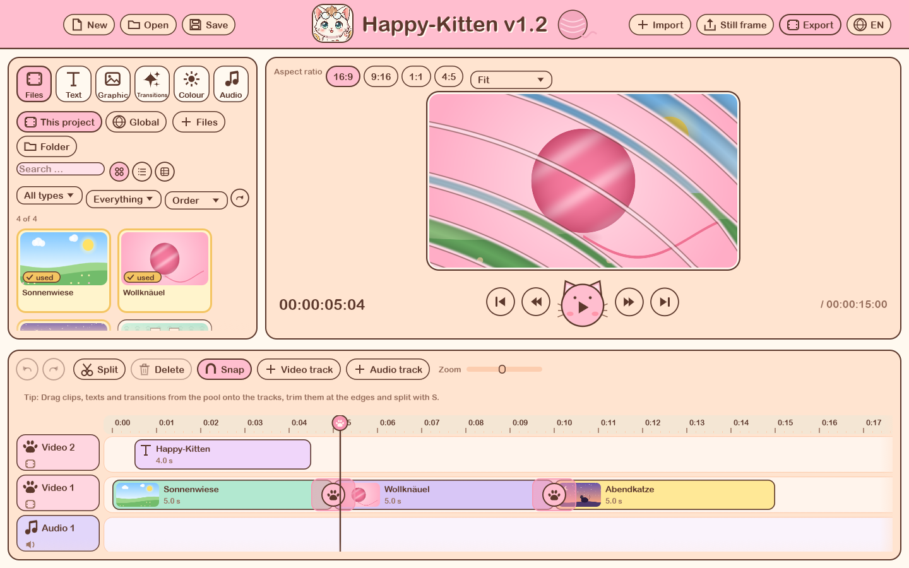
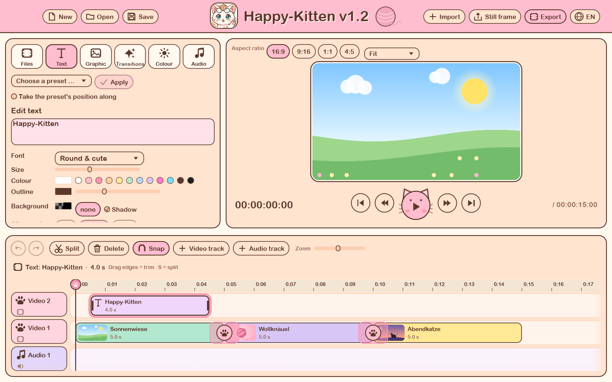
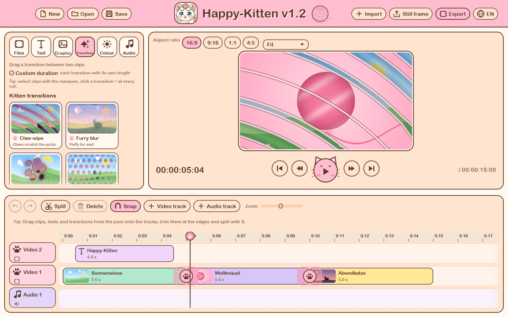
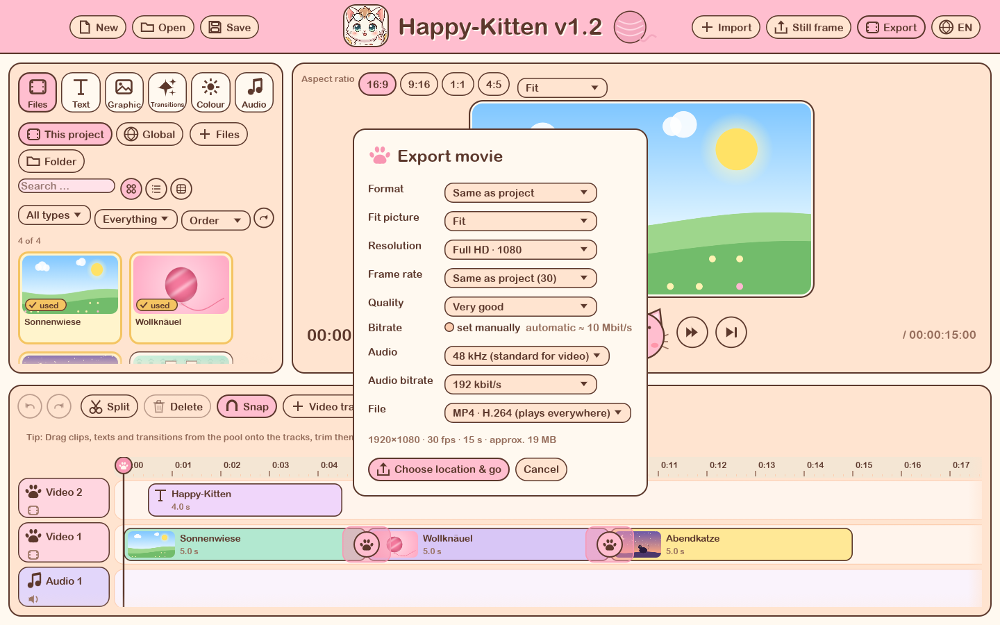
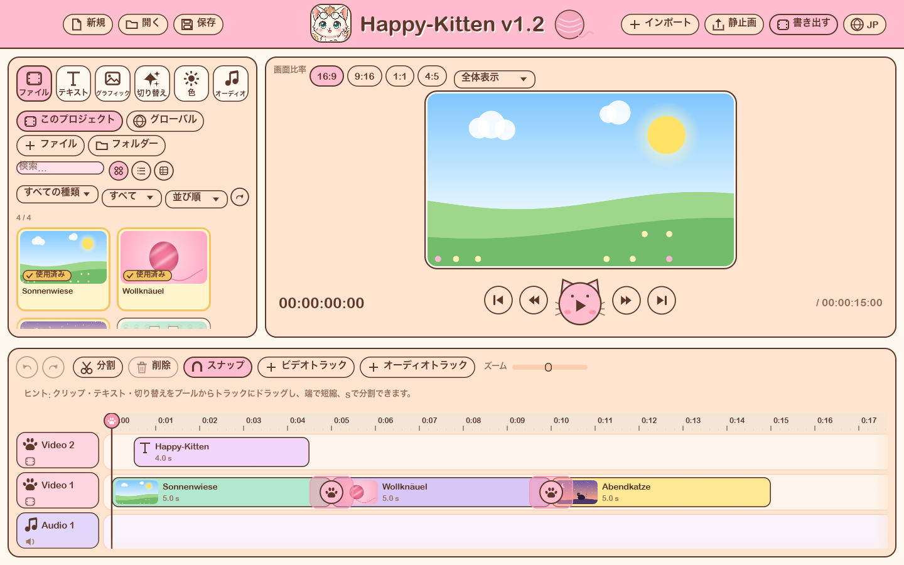

# 🐾 Happy-Kitten v1.2

**English** · [日本語](README.ja.md) · [Deutsch](README.de.md)

**By Gottpot** · open source under MIT or Apache-2.0 · 📺 [YouTube @Gottpot](https://www.youtube.com/@Gottpot)

A local, lightning-fast video editor for the Mac, written in Rust. Image processing runs on the GPU through **wgpu/Metal**, and the interface is sugar-sweet pastel pink instead of Adobe grey.
Everything happens **offline**: no cloud, no account, no telemetry, no subscription.


## Screenshots



| | |
|---|---|
|  |  |
|  |  |

## Download and first launch

Download `Happy-Kitten-….zip` from [Releases](../../releases) (Apple Silicon Mac, macOS 13 or newer), unzip it and drag the app into *Applications*.

I am **not an Apple-certified developer**, so the app is not notarized. macOS may refuse to open it with “is damaged” or “cannot verify the developer”. Do one of these:

1. Right-click the app (or Control-click) → *Open*. On macOS 15 and newer, try to open it once, then click *Open Anyway* in *System Settings → Privacy & Security*.
2. Remove the quarantine flag that the download adds, in Terminal:

```bash
xattr -dr com.apple.quarantine /Applications/Happy-Kitten.app
```

Building the app yourself (see below) never shows this warning. The source code is open and contains no network code.

## Run from source

```bash
# once: install Rust (https://rustup.rs), then
cargo run --release -p happy-kitten
# or build an app bundle plus a ZIP for GitHub Releases:
./scripts/bundle.sh      # creates dist/Happy-Kitten.app
```

A new project is empty, so you can start with your own files right away: drag them into the window or use “Import”.

## Languages

The language button in the top right corner (globe with a country code) switches the interface between **DE · EN · JP · KR · ES**. On first launch Happy-Kitten uses the language of macOS (English if it is not one of these); your choice is remembered in `settings.json` in the app's folder. For development, `HK_LANG=ja` forces a language.

Translations use the German source text as the key: `tr("Speichern")`, with placeholders `trf!("{n} Clips ausgewählt", n = 3)`. All translations live in `apps/happy-kitten/src/i18n_data.rs` (columns: English, 日本語, 한국어, Español); a test checks that nothing is empty and that placeholders match. New text: wrap the key in `tr(…)` in the code and add one row to the table. Another language needs an entry in `Lang` and a column in the table. A missing translation falls back to German.

The translations are machine-assisted and have not been proofread by native speakers. Corrections are very welcome as pull requests.

## How to use it

| Task | How |
|---|---|
| Import media | “Import” (⌘I) or “Files” in the pool: choose **several files at once**; “Folder” takes every video, image, audio file and subtitle in a folder; or just drag them into the window |
| Two kinds of import | At the top of the pool: **This project** (files belong to this project only) or **Global** (a library for all projects, stored in `~/Library/Application Support/Happy-Kitten/library.json`; the files stay where they are). Global clips can be dragged onto the timeline like any other; right-click: add to project / remove |
| Add text | **Text** tab: drag a preset onto a track or click ＋. Select the text clip, then change text, font, size, colour, outline, background, shadow, alignment, position and fade in/out on the left |
| Subtitles and lyrics | **Text** tab → “SRT · LRC · TXT” (or drop the file into the window): every line becomes a text clip on a new track. “Style for all texts on the track” and “Colour lines in pastel” change them all at once |
| Graphics over the video | **Graphic** tab → “Graphic (PNG)”, or simply drag a PNG with transparency onto a video track (images with see-through parts automatically become graphics; right-click “Place over the video as a graphic” works for any image). Select the clip, then set **size, position, rotation, opacity** and fade in/out (crossfade, pixelate, swirl, zoom, …). Several graphics can be changed together, just like text |
| Apply a style to several texts | Select the texts, then in the **Text** tab choose a preset at the top and click “Apply to N texts”, or use the **golden tick** on a preset card, or **right-click** the card or a text clip in the timeline (“Apply preset”). The wording stays, and so does the position unless “Take the preset's position along” is ticked |
| More tracks | “Video track” / “Audio track” in the timeline (up to 8 of each). Upper video tracks lie over lower ones, text lies over the picture. Right-click a track header to delete empty tracks |
| Put on the timeline | Drag a card onto a track, double-click it or click ＋ |
| Move | Drag the clip (it snaps to edges and the playhead and can never overlap) |
| Select several clips | **Drag on an empty area of the tracks** (marquee), or ⇧/⌘-click, or ⌘A. Dragging moves them all, Delete removes them all, ⇧Delete closes the gaps |
| Change several texts uniformly | Select the texts and change them in the **Text** tab: every change applies to all selected texts (only the wording stays per text) |
| Transition at many cuts | Select clips, then click a transition in the **Transitions** tab: it lands on every cut between two selected clips |
| Transition duration | “Custom duration” in the Transitions tab for new transitions; drag the edges of the pink band on the timeline; or click the transition and set it in the field above the timeline |
| Aspect ratio | Above the preview: **16:9**, **9:16** (Shorts, Reels, TikTok), 1:1, 4:5. “Fit”, “Fill” (crop) or “Blurred fill” decides what happens to pictures of another shape |
| Trim | Drag the edges of the clip |
| Split | Set the playhead, press **S** (or ⌘B): splits the selected clip, otherwise every clip under the playhead |
| Delete | **Delete**; with **⇧** the gap closes (or right-click) |
| Insert a transition | In the “Transitions” tab drag one between two clips; change duration and kind in the field above the timeline |
| Play | **Space**; ←/→ step one frame, Home/End jump to the start/end |
| Undo / redo | ⌘Z / ⇧⌘Z |
| Sound settings | Select an audio or video clip, open the **Audio** tab → “Sound”: **volume** (0 to 200 %), **fade in** and **fade out**, and one **effect**: echo, reverb, muffled or telephone, with an amount slider. Several clips can be changed together. Preview, playback and export sound the same |
| Colour | Select a video clip or an image, open the **Colour** tab: **temperature** (cool to warm) and **tint** (green to magenta). Live in the preview and in the export; several clips can be changed together |
| Save / open | ⌘S / ⌘O (`.kitten` files, plain JSON). After saving, a green notice shows “Saved ✓” and the file path for a few seconds |
| Export a movie | “Export” → MP4 (H.264 or HEVC) with sound. Format like the project or 16:9, **9:16 Short**, 1:1, 4:5; resolution = short side (720 / 1080 / 2160 pixels); **frame rate** (23.976 · 24 · 25 · 29.97 · 30 · 50 · 59.94 · 60, for example 24 for Midjourney material); **bitrate** automatic or your own (1 to 150 Mbit/s); **audio** 32 / 44.1 / 48 kHz (AAC) and 128 to 320 kbit/s |
| Still frame | “Still frame” saves the current preview picture as a PNG |
| Crash protection | Unsaved work is copied aside every 30 s (`~/Library/Application Support/Happy-Kitten`) and restored on the next start after a crash; “New”, “Open” and closing ask first |

## File list

The **Files** (and Audio) tab has search, filters (type, used / not used yet) and sorting. Three views: **tiles**, **list** (full file name) and **table** (name, type, duration, size, folder; click the column headers to sort). Everything that is already on the timeline carries a **golden tick** with a golden outline in every view. A tooltip shows the full path.

## Fonts, Japanese and other scripts

The font list shows every font in its own shape. If a font lacks a character (Japanese, Chinese, Korean), a suitable Mac font steps in automatically (Hiragino, Apple SD Gothic); Japanese text without spaces is wrapped between characters. In portrait format the text size follows the picture width.

## Text with effects

Text is drawn with the fonts of the Mac (wrapping, outline, shadow, box) and animated by the GPU. Fade in and out: crossfade, **pixelate**, **swirl**, blur, slide up, zoom in, waves, glitch.
`cargo run -p hk-gpu --example text_sheet -- text.png` shows all effects in five steps.
Your own styles can be saved as a **global preset** and used in every project.

## The paw transitions

All transitions are WGSL shaders (`crates/hk-gpu/src/transitions.wgsl`) that compute the paws and claws **mathematically from distance fields**. There are no pre-rendered images.

| Transition | What happens |
|---|---|
| **Claw Wipe** | six curved scratches tear the picture open, the middle first |
| **Furry Blur** | hair-like smeared fur mist, the picture changes along the strands of fur |
| **Paw Spin** | a giant paw whirls out of the centre, the new picture lies inside it |
| **Gentle Paw Fade** | paw prints tiptoe diagonally across the picture and open windows to the next clip |
| **Kitty Dash** | a galloping kitten runs through the picture with speed lines and a trail of paws |
| **Meow Glitch** | torn lines, RGB offset, block swaps and neon cat heads |

Plus **13 classic transitions**: crossfade, dip to black, dip to white, wipe →, wipe ↓, push, zoom, iris open, clock wipe, barn doors, pixelate, swirl, blur.

### 25 more transitions (1.2)

All computed by the shader as well, in five groups in the Transitions tab:

| Group | Transitions |
|---|---|
| **Noise and cells** | *Paper burn* (fractal noise against progress with a glowing rim), *Shatter* (Voronoi cells tip away one by one, the cell edges stay as lines), *Ink in water* (domain warping like smoke) |
| **Waves and optics** | *Raindrop* (ripples from one point), *Fisheye* (lens zoom), *Zoom blur*, *Spin blur*, *Colour fringe* (chromatic aberration), *Light leak* (a Gaussian streak outshines the cut) |
| **Curves and shapes** | *Sakura* (five-petal rose curve), *Heart iris* (implicit heart curve), *Spiral* (Archimedean spiral wipe), *Paw bloom* (phyllotaxis: paw pads at the golden angle), *Honeycomb* (hexagons flip from the middle), *Kaleidoscope* (angle folded into 1 to 8 mirrored segments) |
| **Manga look** | *Halftone dots* (screentone grid turned by 45°), *Retro dither* (8×8 Bayer matrix), *Tabby stripes* (noise-bent stripes), *Calico cat* (Voronoi patches) |
| **3D and physics** | *Page curl* (cylinder), *Cube*, *Flip* (perspective with a rotation matrix), *Melt* (columns fall with y = ½gt²), *Droste zoom* (log-polar mapping), *Fractal* (Julia set escape time as the mask) |

`cargo run -p hk-gpu --example contact_sheet -- transitions.png` renders all transitions in five steps into one image (`… transitions.png 19 6` only six of them, starting at the 20th), `--example single` renders a single frame in any size.

## Structure

```
crates/
  hk-core    Time (exact ticks), project model, editing operations, undo/redo, saving. No GPU, no UI.
  hk-gpu     wgpu compositor and the transition shaders. Renders into an Rgba8 texture (preview, export, tests).
  hk-media   Images (including graphics with transparency), demo scenes, video through AVFoundation (sequential hardware decoding, MP4 export with AVAssetWriter).
  hk-text    Text rasteriser: fonts, line wrapping, outline, shadow, background box.
  hk-audio   Audio decoding (symphonia), waveform, mixer and playback (cpal). The audio clock leads the picture.
apps/
  happy-kitten  egui interface (own pastel theme, hand-drawn icons), preview engine, export.
```

Design rules:

- **Exact time.** Everything runs in whole ticks (705,600,000 per second, divisible by all common frame and sample rates), never in `f64` seconds.
- **One pipeline for preview and export.** Both use the same compositor, so what you see is what gets exported.
- **The core is testable without a window.** `cargo test --workspace`.
- **Only one place with `unsafe`:** the Apple framework binding in `hk-media` (reading/writing video).

## Developer helpers

Environment variables for automatic checks without a mouse click:

```bash
HK_LANG=en                   # force a language (de, en, ja, ko, es)
HK_DEMO=1                    # start with the three sample scenes on the timeline instead of an empty project
HK_SCREENSHOT=out.png        # saves the window after a short while and quits
HK_PLAYHEAD=5.0 HK_TAB=effects HK_IMPORT=clip.mp4:song.wav  # preset playhead, tab, import
HK_PLAY=1                    # start playback and print the audio clock
HK_EXPORT=film.mp4 HK_HEVC=1 # export in 720p without a dialog, then quit
HK_GLOBAL=1 HK_IMPORT=folder # import into the global library (nothing is saved in developer runs)
HK_TAB=color HK_SELECT_PICTURE=1   # open the Colour tab with the first picture clip selected
HK_FX=echo HK_VOLUME=0.5 HK_FADE=1 HK_TEMP=0.6 HK_TINT=-0.3  # set sound and colour on every clip
HK_BANNER=1                  # show the green "saved" notice
HK_SCRIPT=build|text         # replays mouse actions (drag, trim, transition, text, library); with HK_DUMP=1 the timeline is printed
```

## Relationship to filmcraft

Happy-Kitten was built with [storytold/filmcraft](https://github.com/storytold/filmcraft) (MIT OR Apache-2.0) as a reference: a wgpu compositor in a linear pipeline, exact integer time, commands instead of special cases, egui for the UI. It is its **own, lean core**; no code was taken over. The reason not to use filmcraft as a dependency: it aims at Premiere parity (50+ crates, its own codecs), while Happy-Kitten deliberately carries little ballast. filmcraft's pure-Rust codecs (`h264`, `hevc`, `aac`, `isobmff` …) remain the obvious option for a later Windows/Linux port.

## Author and licence

Created by **Gottpot**. The source code is available under either the [MIT licence](LICENSE-MIT) or the [Apache licence 2.0](LICENSE-APACHE), © 2026 Gottpot. You may use, change and share it, commercially too, as long as you keep the licence notice.

- **Logo:** `assets/logo.png` is © Gottpot and is **not** part of the free licence, see [assets/LICENSE.md](assets/LICENSE.md). Whoever publishes a fork replaces it with their own.
- **Libraries:** All third-party libraries use free licences (MIT, Apache-2.0, Zlib, BSD, MPL-2.0, …), listed in [THIRD-PARTY-LICENSES.md](THIRD-PARTY-LICENSES.md) (generated with `python3 scripts/third_party_licenses.py`). The fonts for text clips are not shipped; they are read from macOS at run time.
- **Changelog:** see [CHANGELOG.md](CHANGELOG.md) for what changed in each version.
- Contributions are welcome, see [CONTRIBUTING.md](CONTRIBUTING.md). This is a hobby project and not legal advice.

## What's next

- Move text freely on the picture (for now via the position field)
- Picture-in-picture: size and position of video clips
- Speed per clip
- Audio crossfades at cuts
